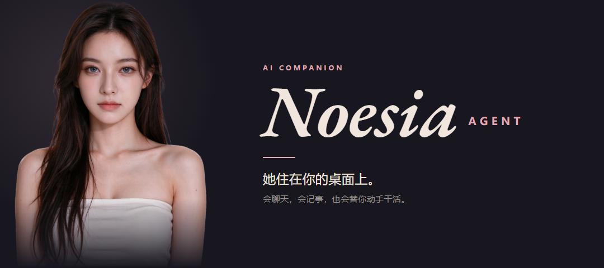

  

[她会什么](#她会什么) · [看演示](#看她干一次活) · [安装](#安装) · [第一次打开](#第一次打开) · [怎么用](#怎么用)

---

## 她会什么

- 🪟 **桌面形象** —— 无边框、置顶、透明，能拖能缩放，位置和大小下次启动还在原地
- 💬 **文字对话** —— 双击头像开聊天窗，流式回显；工具调用一行一行给你看
- 🔀 **模型切换** —— 供应商 → 模型 两级菜单，换完下一句就生效，上下文接着聊
- 🔊 **语音朗读** —— Edge / ElevenLabs / 豆包三选一，**247 个音色 / 18 种语言**
- 🎭 **语音互动** —— 说话时换成实时画面，口型跟着音频走（Vidu，1 积分/秒；只有按下发送才建会话）
- 🧠 **身份记忆** —— `SOUL.md` 是她是谁，`memories/` 是她记住的事，都由她自己读写
- 🛠 **动手干活** —— 终端、读写文件、联网都是真工具，随包 58 个技能，另有 152 个可选


## 看她干一次活

https://github.com/user-attachments/assets/bce248c6-16c5-49a8-831f-ec23d15c23b2

*双击头像，说一句话，剩下的她自己来。*

---

## 安装

### 方式一：整合包（推荐）

> [!TIP]
> 什么都不用装。包里带着 Python、ffmpeg 和 git bash，解压就能跑。

1. 到 Releases 下载最新的整合包，解压到任意文件夹
2. 双击 `setup.bat` —— 第一次装依赖，几分钟
3. 双击 `Noesia.exe`（打不开就用 `Noesia.vbs`）

### 方式二：克隆仓库

```bash
git clone https://github.com/raydoomed/Noesia-Agent.git
cd Noesia-Agent
```

进去双击 `setup.bat`。机器上没有 Python 3.14 时它自己下一份放进 `vendor/python314`，
依赖走网络源装（阿里云 → 中科大 → 官方），ffmpeg 与 ARTC 运行库也一并补上。装完双击 `Noesia.exe`。
整个过程联网约几分钟，全程只动项目文件夹，不写注册表、不改系统 PATH。

## 第一次打开

**给它一个模型** —— 聊天窗右上「设置」→ 圈一家「启用」→ 粘 API 密钥 → 选模型 → 保存并启用，当场生效。
想手填就把 `.env.example` 复制成 `data/NoesiaHome/.env`，填 `DEEPSEEK_API_KEY=...` 这类。

**想让它出声** —— 输入框左边的语音按钮打开朗读（默认 Edge，免费、不要密钥）；不想听就切「静音」。

**想换名字性格** —— 设置 → 人设，改完下一句生效；改坏了点「恢复初始人格」。

## 怎么用

| 操作 | 效果 |
|---|---|
| 双击头像 / 右键 | 打开聊天窗 |
| 拖动窗口 / 拖边缘 | 移动；缩放锁形象宽高比，最小宽 180 |
| 输入框左边 `思考` / `审批` | 切思考档与审批档，立即生效 |
| `Esc` | 藏起来，进程和对话都还在 |
| 右键 → 退出 | 真的退出 |

## 数据在哪

全在项目文件夹的 `data/` 里，不上传：`NoesiaHome/config.yaml`（配置）、`SOUL.md` 与 `memories/`（人设与记忆）、`state.db`（会话）、`runtime/*.log`（日志）。删掉 `data/` 就回到刚装好的状态。

---

## 目录

```
Noesia Agent/
├── Noesia.exe   Noesia.vbs        # 双击启动（exe 只是壳）
├── setup.bat    uninstall.bat     # 装 / 卸
├── src/                           # app/ 界面 · engine/ 内置引擎 · 入口脚本
├── assets/                        # 形象图、待机视频、截图与演示
├── vendor/                        # 随包运行环境（整合包自带；源码副本由 setup 自动补）
├── data/                          # 运行时数据（首次启动自动建，不入库）
├── scripts/   tools/   tests/     # setup.ps1 / uninstall.ps1 · 构建脚本 · 测试
├── pyproject.toml   Makefile   VERSION
├── app.example.json   .env.example
├── README.md   LICENSE
└── .gitignore   .gitattributes
```

## 技术栈

Python 3.14 · PySide6（Qt 6）做界面 · 界面和引擎是两个进程，走本机 WebSocket 通信 · 引擎代码在 `src/engine/`，依赖单独一份清单 `src/engine/deps.txt`

## 许可

[MIT](LICENSE)。`assets/` 里的形象素材版权归各自作者，换自己的形象请自备并获得授权。

